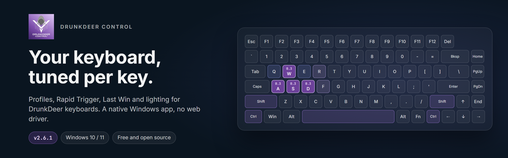
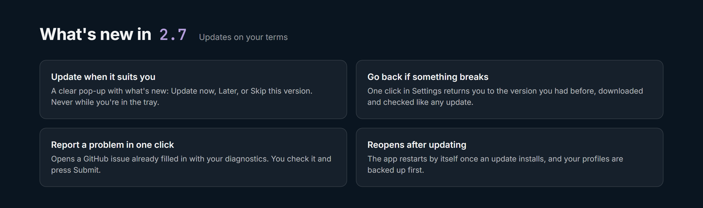
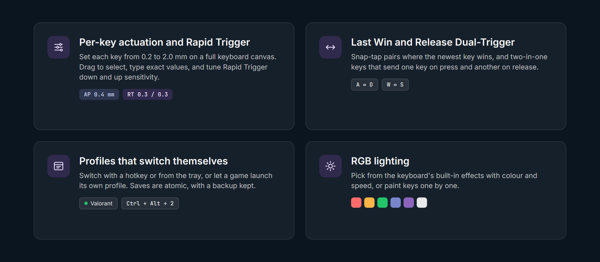
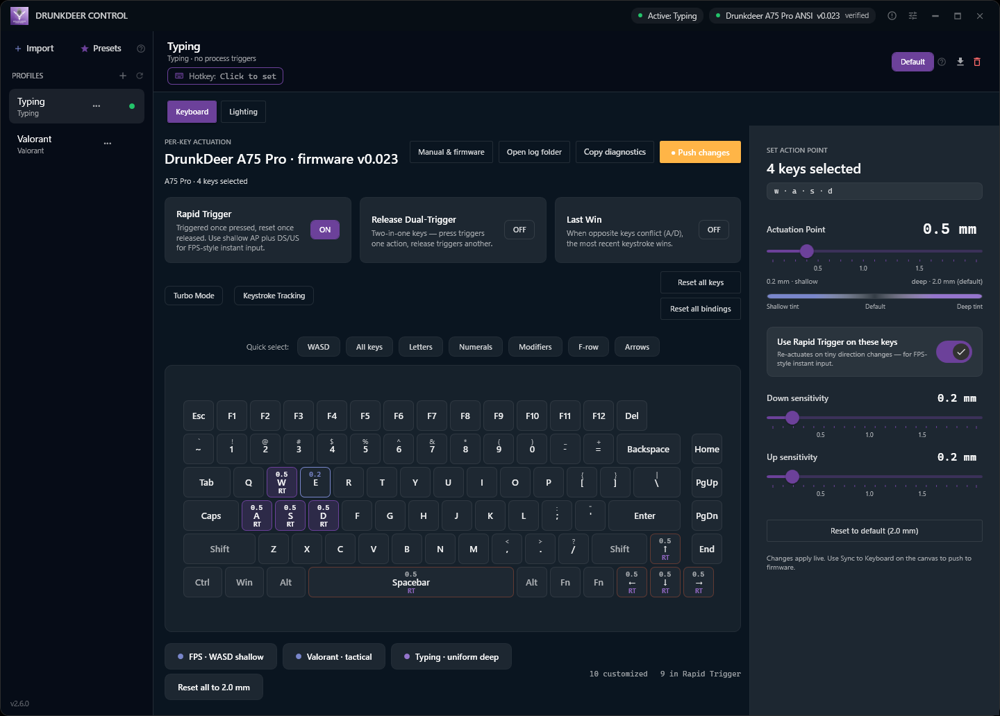
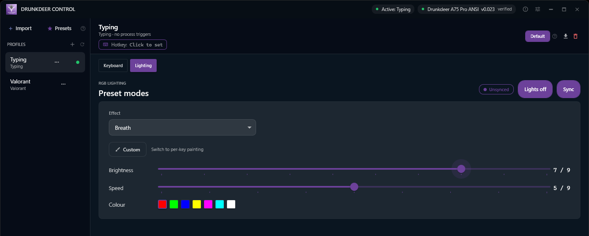

<p align="center">
  
</p>

<p align="center">
  <a href="../../releases/latest"></a>
  
  
  
  
  
</p>

<p align="center">
  <a href="../../releases/latest"><b>Download for Windows</b></a> ·
  <a href="#features">Features</a> ·
  <a href="#supported-keyboards">Supported keyboards</a> ·
  <a href="#faq">FAQ</a>
</p>

---

## What is this?

DrunkDeer Control is a free, open-source Windows app for tuning and managing DrunkDeer keyboards without the web driver. Set **per-key actuation** on a live keyboard canvas, build as many profiles as you like, and switch between them from the tray, a hotkey, or automatically when a game starts.

It detects your keyboard model, runs in the system tray, and keeps the keyboard in sync with the profile you choose. Profiles are stored locally as JSON and import from the official DrunkDeer web driver.

> Tested on Windows 10/11 with the A75 Pro (firmware 0.023, verified) and G65 (firmware 0.48). Other models are supported through the 19-model layout catalog but are less tested — reports are welcome.

<p align="center">
  
</p>

---

## Features

<p align="center">
  
</p>

### Keyboard performance view
- A keyboard canvas that matches your detected model's layout.
- Click a key, **drag a marquee**, or Ctrl/Shift-click to select several.
- Per-key **Actuation Point** (0.2–2.0 mm), plus Rapid Trigger **Down** and **Up** sensitivity. Drag the sliders or type exact values.
- Heat-map shading, an **RT** badge on every Rapid Trigger key, quick-select pills (WASD, arrows, modifiers…) and one-click presets (FPS, Valorant, Typing).
- Live **keystroke-depth bars** while Keystroke Tracking is on.

<p align="center">
  
</p>

### Modes
- **Rapid Trigger** · **Release Dual-Trigger** · **Last Win** · **Turbo** · **Keystroke Tracking**, toggled from the mode strip.
- **Last Win** pairs (e.g. A ↔ D, W ↔ S): the most recent key wins. Add them with one click.
- **Release Dual-Trigger** pairs: one key sends one input on press and another on release.
- Coupling rules are handled for you (Last Win / RDT turn Rapid Trigger on and Turbo off).

### Key remapping
Rebind any key from the actuation drawer, including PrtSc, Scroll Lock and Pause. Remaps are saved per profile.

### RGB lighting
Pick one of the keyboard's built-in effects with brightness, speed and colour, or switch to **Custom** and paint keys one by one.

<p align="center">
  
</p>

### Profiles
- Create, duplicate, rename and delete profiles; add notes; import from the web driver.
- Saves are **atomic** with a rolling backup, and a profile that can't be read is set aside with a notice instead of disappearing.
- Changes save instantly; **Push changes** sends them to the keyboard.

### Switching profiles — three ways
| Method | How |
|---|---|
| **System tray** | Right-click the deer icon → pick a profile |
| **Hotkey** | `Ctrl + End` cycles profiles; any profile can also have its own direct hotkey |
| **Process trigger** | Switch automatically when a chosen app comes to the foreground |

> If a profile is marked as **default**, it's applied whenever the foreground app has no profile of its own. For hotkey/tray-only switching, leave no profile as default.

### Built to stay out of the way
- Runs in the tray; optional **Start with Windows** and `--start-minimized`.
- **Updates on your terms**: a pop-up with what's new (Update now, Later, or Skip this version). The update installs in place after its SHA-256 is checked, and the app reopens by itself. No installer, no admin rights.
- **Go back** to the version you had before from Settings if an update causes trouble, and **Report an issue** opens a pre-filled GitHub issue.
- **Copy diagnostics** puts your model, raw firmware, and last sync summary on the clipboard for bug reports.

---

## Supported Keyboards

| Keyboard | Firmware | Status |
|---|---|---|
| DrunkDeer A75 Pro | 0.023 (`0x0017`) | Verified |
| DrunkDeer G65 | 0.48 | Tested |
| A75 / A75 Ultra / A75 Master and other VID `0x352D` models | — | Supported (19-model layout catalog). On A75 Ultra and Master, remap and key-pair writes ask for confirmation first. |

Supported PIDs: `0x2382`, `0x2383`, `0x2384`, `0x2386`, `0x2387`, `0x024f`, `0x2391`, `0x2a08`

> Keyboard not detected? Open an issue with the [keyboard support form](../../issues/new/choose) — it asks for the PID, firmware and model.

---

## Installation

### Option A — Download (recommended)
1. Download `DrunkDeer-Control.exe` from [Releases](../../releases/latest). A `.sha256` file is published next to it if you want to check the download.
2. Run it — no installer, no admin rights. On first launch it installs itself to a managed location and keeps itself updated from there.

<details>
<summary><b>Option B — Build from source</b></summary>

**Requirements:** .NET 10 SDK (pinned by `global.json`), Windows 10/11

```bash
git clone https://github.com/svumo/DrunkDeer-Control.git
cd DrunkDeer-Control
dotnet build DrunkDeerDriver.sln
dotnet test tests/Driver.Tests
dotnet run --project WpfApp/WpfApp.csproj -- --no-install-redirect
```
</details>

---

## Importing Profiles

1. Open the [DrunkDeer web driver](https://en.drunkdeer.com/pages/driver).
2. Configure your profile and export it as a JSON file.
3. In DrunkDeer Control, click **Import** and select the file.

See [Importing-Profiles.md](Importing-Profiles.md) for a step-by-step walkthrough.

---

## FAQ

<details>
<summary><b>Windows Defender flags the exe as a threat</b></summary>

A false positive common to unsigned apps. The source is fully open — audit it, check the published SHA-256, or build from source.
</details>

<details>
<summary><b>The app doesn't detect my keyboard</b></summary>

Check Device Manager for a `VID_352D` device listed as "HID-compliant vendor-defined device". If the PID isn't in the supported list, open an issue with the [keyboard support form](../../issues/new/choose).
</details>

<details>
<summary><b>A key got stuck after changing Last Win settings</b></summary>

Fixed in 2.6: the key-pair table is only rewritten when your pairs actually change, and the app asks you to keep your hands off the keyboard for the second it takes. If it still happens, unplug and replug the keyboard, then use **Copy diagnostics** and open an issue.
</details>

<details>
<summary><b>Profile switching via hotkey doesn't work</b></summary>

Make sure at least two profiles are marked as **Quick Switch** in their settings. The hotkey cycles only through quick-switch profiles.
</details>

<details>
<summary><b>Process trigger doesn't activate</b></summary>

A default profile overrides process triggers. Un-set the default profile if you want app-based switching.
</details>

<details>
<summary><b>Reporting an issue — what should I attach?</b></summary>

Use **Settings → Report an issue**: it opens the [bug report form](../../issues/new/choose) already filled in with your diagnostics (or click **Copy diagnostics** and paste it yourself). If asked for more, attach `%APPDATA%\DrunkDeer Control\debug.log` (and `debug.log.old` if present).
</details>

---

## Requirements & how it works

Windows 10 or 11 (64-bit). No admin rights, nothing to install — .NET 10 is bundled in the exe.

DrunkDeer keyboards keep only the active profile on the keyboard itself. The app stores your profiles and writes the chosen one over USB when you switch profile or press **Push changes**. Opening the app writes nothing, so the keyboard stays as you left it. Changes made in the official web driver aren't seen by the app — re-import to pick them up.

---

## Privacy

No telemetry: no ping, no device ID, nothing counted. The app makes two anonymous `GET` requests and sends nothing about you or your keyboard.

<details>
<summary>The two network calls</summary>

1. **GitHub releases API** — checks for a newer release and shows the update banner (`api.github.com/repos/svumo/DrunkDeer-Control/releases/latest`). See [`WpfApp/UpdateChecker.cs`](WpfApp/UpdateChecker.cs). Updates download from GitHub only and install only if their SHA-256 matches.
2. **DrunkDeer firmware-version channel** — checks whether your keyboard's firmware is older than the latest DrunkDeer publishes (`drunkdeer-telemetry.svumo.workers.dev/firmware`, a Cloudflare Worker in [`telemetry-worker/`](telemetry-worker/); the folder name is kept for URL stability). See [`WpfApp/FirmwareUpdateChecker.cs`](WpfApp/FirmwareUpdateChecker.cs).

The Worker has `[observability] enabled = false` in [`telemetry-worker/wrangler.toml`](telemetry-worker/wrangler.toml) and never reads `cf-connecting-ip`.
</details>

---

## Changelog

**v2.7.0** — Updates on your terms:
- **Update pop-up** with the release notes: Update now, Later, or Skip this version. It waits until you open the window if the app started in the tray.
- **Go back to your previous version** from Settings (downloaded and SHA-256-checked like any update); your profiles are backed up before every update.
- **Report an issue** in Settings opens a public GitHub issue pre-filled with your diagnostics — you review it before posting.

<details>
<summary><b>v2.6.1 and v2.6.0</b> — reopen after updating; safer syncs and a sturdier app</summary>

- **v2.6.1:** the app now reopens after an in-app update (the new version waits for the old one to close instead of mistaking it for a second copy).

- **No more stuck keys:** the Last Win / RDT pair table is only rewritten when pairs change, the app waits for keys to be released, and a hands-off overlay shows during the rewrite.
- **Nothing written on launch** (#6), and Last Win no longer adds pairs by itself — use **Add A/D + W/S**.
- **A75 Ultra / Master:** remap and pair writes ask for confirmation first (#6).
- **Profiles:** atomic saves with a rolling backup, a notice for unreadable files, New and Duplicate.
- **Updates:** SHA-256-verified downloads with timeouts; now on **.NET 10**.
- **Other fixes:** tray Exit always quits (#7); only the real gen-2 A75 Pro PID is treated as one (#2); RDT one-way pairs explained (#9).
- **Also new:** bind PrtSc / Scroll Lock / Pause (#8), **Copy diagnostics** and issue forms, type exact mm values, clearer Rapid Trigger hints.
</details>

<details>
<summary>Earlier releases</summary>

- **v2.5.1** — G60 / G65: fixed the Esc key typing backtick (`` ` ``) instead of Escape
- **v2.5.0** — First non-beta 2.x release: Last Win fixed on gen-1, RGB lighting tab with preset effects, explicit Sync model with per-profile Discard, hotkeys require a modifier, bundled Typing + Valorant presets
- **v2.4.0** — Firmware-aware wire dialect dispatch, Release Dual-Trigger pair fix across profile switches, firmware-too-old upgrade prompt
- **v2.3.0** — Removed all usage telemetry; only two passive GETs remain
- **v2.2.0** — Actuation-point wire-scale fix (`byte = mm × 100`), multi-firmware capability tiers (Verified / Beta / Unknown), sync over-send pruning
- **v2.1.2** — Fresh installs auto-create a default profile
- **v2.1.1** — Robustness fixes
- **v2.1.0** — Multi-keyboard support (19-model layout catalog), keyboard performance view, keystroke-depth bars
- **v2.0** — Keyboard view rebuild: visual canvas, drag-marquee multi-select, per-key drawer, presets, remapping, mode strip
- **v1.3–v1.6** — In-app auto-update, canonical install + redirect, firmware update banner, single-instance handling
- **v1.1–v1.2** — Dashboard redesign, global hotkey, per-profile keybinds, notes, inline rename
- **v1.0** — DrunkDeer Control rebrand: A75 Pro support, modernized JSON import
- **v0.2** — Release double trigger, last win, key remapping
- **v0.1** — Initial release: profiles and rapid trigger
</details>

---

## License

MIT — see [LICENSE](LICENSE)
